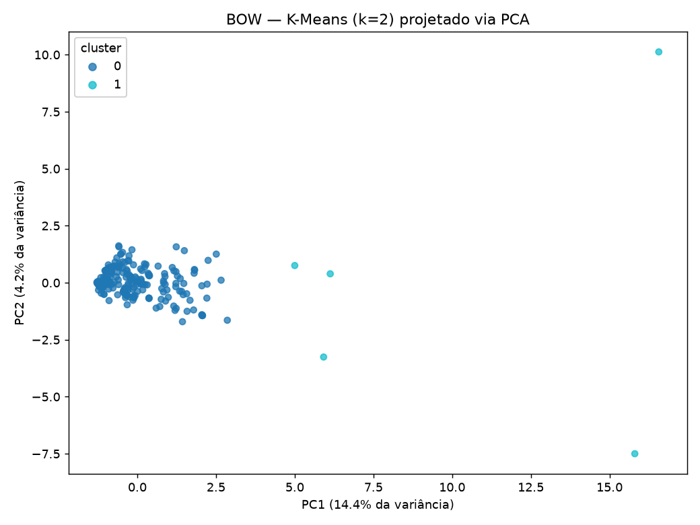
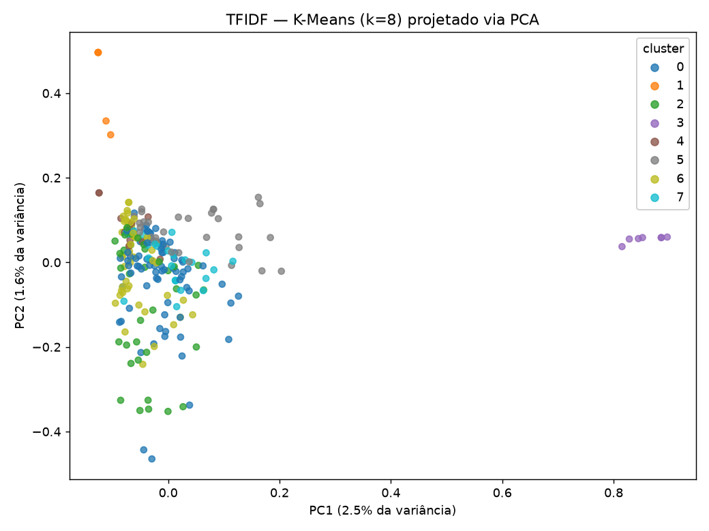
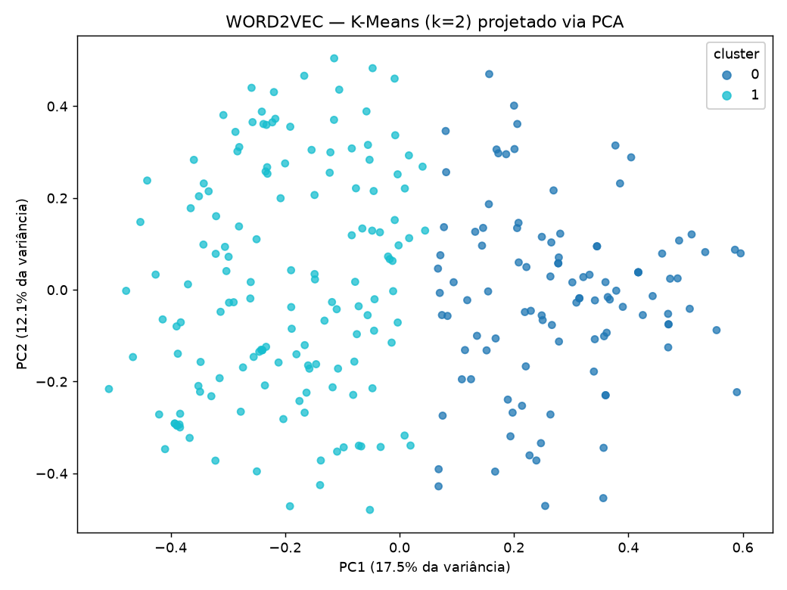
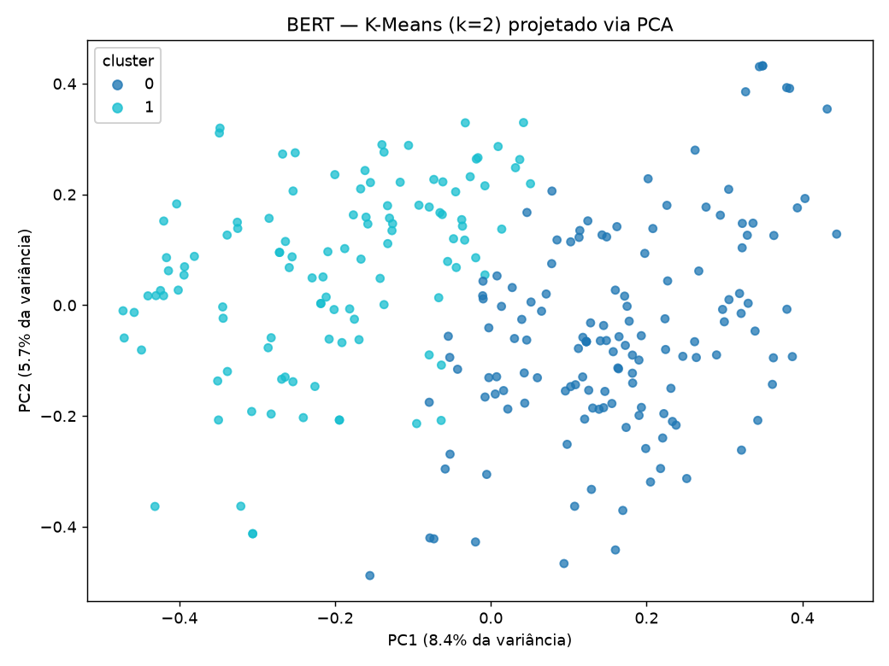

# Item 2 — Clusterização, PCA e visualização

> **Uso de IA generativa**: código (`clusterizacao_pca.py`) e esta análise
> desenvolvidos com apoio do **Claude (Anthropic, Sonnet 4.5/5)** via Claude
> Code, a partir de prompt pedindo a implementação de K-Means + PCA sobre as
> quatro representações já construídas no item 3, e a interpretação crítica
> dos resultados reais obtidos.

## Metodologia

Mesmo corpus do item 3 (253 `context_excerpt`) e as mesmas quatro
representações (BoW, TF-IDF, Word2Vec do zero, BERT pré-treinado). Para cada
representação: testamos K-Means com k de 2 a 8, escolhemos o k de maior
*silhouette score* geral, projetamos em 2D via PCA só para visualização (o
agrupamento roda no espaço original de cada representação, não no espaço
reduzido), e calculamos métricas intra-cluster (distância média ao
centroide) e inter-cluster (distância entre centroides, silhouette score).
Código em `clusterizacao_pca.py`; números completos em
`resultados_clusterizacao.json`; imagens em `figuras/`.

## Resultado por representação

| Representação | melhor k | silhouette geral | tamanho dos clusters |
|---|---|---|---|
| BoW | 2 | **0.575** | 248 / 5 |
| TF-IDF | 8 | 0.027 | 77 / 5 / 35 / 7 / 12 / 34 / 57 / 26 |
| Word2Vec | 2 | 0.133 | 105 / 148 |
| BERT | 2 | 0.055 | 140 / 113 |






## Qual representação gerou os clusters mais representativos?

**Nenhuma — e isso é o achado mais importante deste item.** O silhouette
score mais alto de longe (BoW, 0.575) parece, à primeira vista, indicar o
melhor agrupamento. Mas ao inspecionar os 5 documentos do cluster minoritário
e comparar o tamanho médio de texto entre os dois clusters:

| cluster BoW | n | tamanho médio do texto (caracteres) |
|---|---|---|
| 0 | 248 | 118,7 |
| 1 | 5 | **617,2** |

O "cluster" nada mais é do que uma separação entre os poucos documentos
muito longos (378–985 caracteres — telegramas, atas, notícias políticas
extensas) e a maioria dos documentos curtos (recortes de coluna social,
24–607 caracteres). Isso é esperado e conhecido na literatura: contagens
brutas de palavras (BoW) crescem com o tamanho do documento, então a
distância euclidiana entre vetores BoW é dominada por magnitude/tamanho, não
por conteúdo temático. Um silhouette alto aqui mede "separação por
tamanho", não "separação por significado" — é um resultado tecnicamente
correto, mas **não representativo** do conteúdo.

O TF-IDF, com k=8, também não produziu clusters tematicamente interpretáveis
(silhouette geral de 0,027, essencialmente ruído) — só os clusters 1 e 3
(silhouette 0,479 e 0,633, respectivamente, os mais altos de toda a
clusterização TF-IDF) fogem disso, e ao ler os exemplos descobrimos por quê:
são **o mesmo anúncio classificado reimpresso em várias edições seguidas do
jornal** (ex.: "Não atire seu espelho ao canto, mande-o reformar na Fábrica
de Espelho de Alvina Effting..." aparece 3 vezes idêntico no cluster 3; "Ivo
Ranghetti Jair Effting Jair Fernandes" aparece 3 vezes idêntico no cluster
1). Ou seja: os clusters de maior coesão do TF-IDF inteiro são duplicatas
(quase-)exatas — um artefato de como classificados de jornal eram
republicados, não uma categoria semântica real.

Word2Vec (silhouette 0,133) e BERT (silhouette 0,055) produziram divisões
binárias fracas, sem um tema identificável claramente ao ler os exemplos de
cada cluster — ambos misturam listas de nomes, notas sociais e menções
avulsas dos dois lados da divisão. A estrutura é fraca demais pra sustentar
uma leitura qualitativa de "isto é o cluster de X".

**Conclusão**: nenhuma das quatro representações produziu clusters que
capturassem categorias semânticas reais (tipo de evento, por exemplo) de
forma confiável. Os números de silhouette mais altos vieram de artefatos —
tamanho de documento (BoW) e duplicação de texto (TF-IDF) — não de estrutura
temática. Isso é consistente com a composição do corpus: é um conjunto de
menções a um único sobrenome extraídas de contextos extremamente variados
(nascimento, casamento, óbito, política, classificados, coluna social), sem
uma categoria dominante clara o bastante pra formar agrupamentos naturais
num corpus de só 253 documentos curtos.

## Quantidade de clusters que melhor expressaria os dados originais

Dado que o `event_type` já extraído na Unidade 1 tem só 4 categorias
(`outro`, `nascimento`, `casamento`, `obito`) e é extremamente desbalanceado
(248/253 são "outro" — ver item 4), um k pequeno (2–4) seria o teoricamente
esperado se as representações capturassem essa estrutura. Na prática, o k
"ótimo" por silhouette variou de 2 a 8 sem convergir pra um valor consistente
entre representações, e nenhum deles correspondeu às categorias de evento
reais (os 5 documentos com evento diferente de "outro" terminaram
espalhados entre clusters, não concentrados num só — conferível em
`resultados_clusterizacao.json`). Isso reforça a conclusão acima: o corpus,
do jeito que está (curto, ruidoso, sem categoria dominante), não tem uma
quantidade de clusters "certa" que o k-means consiga achar de forma
confiável — o k escolhido por silhouette está otimizando um artefato
geométrico da representação, não uma partição temática latente.

## Interpretação das métricas intra/inter-cluster

- **Intra-cluster (distância média ao centroide)**: mede o quão compactos
  são os clusters. Valores completos em `resultados_clusterizacao.json`
  (`distancia_intra_cluster`). Em todas as representações, o cluster
  minoritário (quando existe) tem distância intra maior que o majoritário —
  esperado, já que agrupa documentos "atípicos" (muito longos no BoW,
  duplicatas raras no TF-IDF) com menos vizinhos próximos.
- **Inter-cluster (distância entre centroides + silhouette geral)**: mede
  separação entre grupos. O silhouette geral baixo de TF-IDF/Word2Vec/BERT
  (0,027–0,133) já indica sobreposição substancial entre clusters — não há
  "vales" claros no espaço vetorial que seperem grupos de documentos. Só o
  BoW teve separação forte (0,575), e já vimos que é separação por tamanho de
  texto, não por conteúdo.

## Reprodutibilidade

```powershell
python -m trabalho_unidade3.clusterizacao_pca
```
